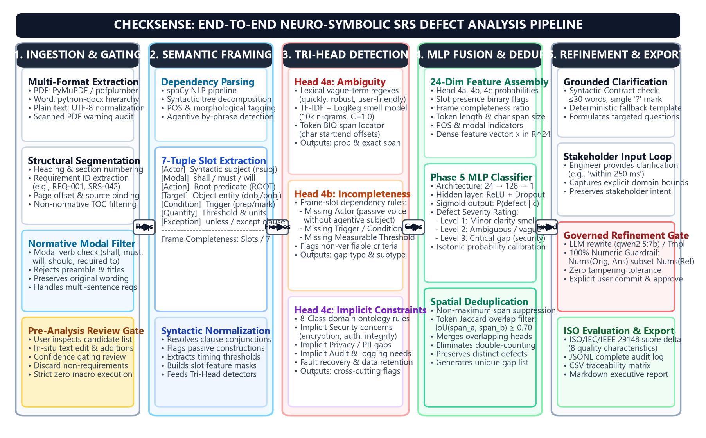
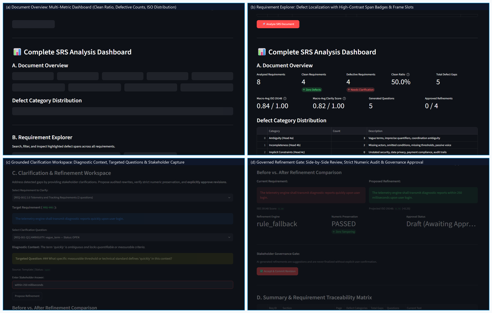

# CheckSense

[](LICENSE)
[](https://www.python.org/)
[](tests/)
[-red.svg)](docs/CheckSense_IEEE_Report.pdf)
[](docs/)

**CheckSense** is an auditable, neuro-symbolic Natural Language Processing (NLP) framework designed for software engineering specifications. It analyzes full Software Requirements Specification (SRS) documents, detects requirement-level defects (ambiguity, incompleteness, and implicit constraints), explains identified gaps, formulates grounded clarification questions for stakeholders, and iteratively refines requirements while enforcing a **100% strict numeric preservation guardrail** and tracking **ISO/IEC/IEEE 29148** quality scores.

---

## 📌 System Architecture

CheckSense bridges computational linguistics, domain ontologies, neural classification, and human governance into an auditable pipeline:



The framework operates across five coordinated subsystems:

1. **Document Ingestion & Gating:** Multi-format parser (PDF via PyMuPDF/pdfplumber, Word `.docx`, Plaintext `.txt`), heading/section hierarchy tracker, normative modal verb filter (`shall`, `must`, `will`, `should`), and an interactive Pre-Analysis Review Gate.
2. **Semantic Frame Parser:** A spaCy dependency parsing engine decomposes each sentence into a structured 7-tuple semantic frame:
   $$\text{Frame} = \langle \text{Actor}, \text{Modal}, \text{Action}, \text{Target}, \text{Condition}, \text{Quantity}, \text{Exception} \rangle$$
   and computes slot completeness scores ($\text{Slots}_{\text{present}} / 7$).
3. **Tri-Head Defect Detection:**
   - **Head 4a (Ambiguity & Vagueness):** Lexical vague-term regular expressions (NASA / ISO 29148 lexicons), TF-IDF vectorizer (10,000 n-grams) + Logistic Regression smell classifier, and a token-level BIO sequence tagger for exact character offset localization.
   - **Head 4b (Incompleteness & Structural Gaps):** Frame-slot completeness rules identifying agentless passive voice (missing actor), untriggered reactive behaviors (missing condition), and non-verifiable operational limits (missing threshold).
   - **Head 4c (Implicit Constraints & Cross-Cutting Concerns):** 8-class domain ontology checklist identifying unstated requirements in security (encryption, TLS, auth), privacy (PII, consent), auditability (logging, timestamping), and fault recovery.
4. **Candidate-Level MLP Fusion & Deduplication:** Assembles a 24-dimensional dense feature vector per candidate gap, evaluates calibrated defect probabilities $P(\text{defect} \mid c)$ and 3-level severity ratings via a 128-unit Multi-Layer Perceptron (MLP), and applies token-level Jaccard spatial deduplication ($\text{IoU} \ge 0.70$) to prevent multi-head double counting.
5. **Governed Refinement & Quality Evaluation:** Formulates grounded clarification questions adhering to a strict syntactic contract ($\le 30$ words, single `?`), integrates stakeholder domain answers, applies dual-path refinement (local Ollama `qwen2.5:7b` with deterministic template fallback), enforces a **100% strict numeric preservation guardrail** ($\text{Numbers}(\text{Orig}) \cup \text{Numbers}(\text{Ans}) \subseteq \text{Numbers}(\text{Ref})$), evaluates ISO/IEC/IEEE 29148 conformance deltas, and exports full traceability artifacts.

---

## 🖥️ Interactive Web Studio Interface

The CheckSense Streamlit studio provides an intuitive, end-to-end audit workbench:



- **(a) Document Overview:** High-level dashboard displaying analyzed requirement counts, clean requirements, defective counts, clean ratio, defect category distributions, and macro ISO 29148 scores.
- **(b) Requirement Explorer:** Live inspection card per requirement with localized span badges (e.g., `quickly` [Ambiguity: vague_predicate]), 7-tuple frame slot breakdown, and severity ratings.
- **(c) Clarification Workspace:** Diagnostic context, targeted questions, and an interactive input field capturing domain clarifications from stakeholders.
- **(d) Governed Refinement Gate:** Side-by-side Before/After diff, projected ISO 29148 delta, the real-time **`Numeric Preservation: PASSED (Zero Tampering)`** audit badge, and the explicit **`Accept & Commit Revision`** governance button.

---

## 🔍 Three Defect Categories Detected

| Defect Category | Subtypes Detected | Technical Detection Method | Example Flawed Requirement |
| :--- | :--- | :--- | :--- |
| **1. Ambiguity & Vagueness** | `vague_predicate`<br>`vague_quantifier`<br>`anaphora`<br>`coordination` | • RegEx dictionary matching (NASA & ISO 29148 lexicons)<br>• TF-IDF (10k n-grams) + Logistic Regression ($C=1.0$)<br>• Token BIO Sequence Tagger (character offsets) | *"The telemetry engine shall transmit diagnostic reports **quickly** upon user login."* |
| **2. Incompleteness & Gaps** | `missing_actor`<br>`missing_condition`<br>`missing_threshold` | • Syntactic dependency slot rules<br>• Passive voice detection without agentive by-phrase<br>• Subordinate clause triggers & threshold validation | *"Azimuth angles shall be calibrated before tracking commences."* *(Missing responsible actor)* |
| **3. Implicit Constraints** | `implicit_security`<br>`implicit_privacy`<br>`implicit_audit`<br>`data_retention` | • 8-Class domain ontology matrix<br>• Keyword taxonomy & cross-cutting concept checklist | *"The system shall store member passwords in the database."* *(Missing encryption / hashing)* |

---

## 📊 Datasets & Roles

CheckSense was developed and evaluated using authentic software engineering corpora in accordance with [docs/DATASHEET.md](docs/DATASHEET.md):

| Dataset | Size / Scale | Role in CheckSense | License / Provenance |
| :--- | :--- | :--- | :--- |
| **PURE Corpus** | 13,394 raw sentences $\to$ 3,568 cleaned requirements across 26 industrial specs | Requirements language modeling, corpus statistics, and syntactic parsing evaluation | Zenodo (`10.5281/zenodo.1414116`), CC-BY-4.0 (Ferrari et al.) |
| **ARTA Benchmark** | 425 requirements across 17 industrial domains | Gold smell benchmark; training and evaluation of Head 4a smell classifier | Zenodo (`10.5281/zenodo.4266727`), Academic Research Use (Femmer et al.) |
| **QuRE Benchmark** | 230 requirements annotated for quality smells | Independent cross-dataset smell evaluation benchmark | Zenodo (`10.5281/zenodo.7897601`), Academic Research Use (Šenkýř & Kroha) |
| **Pilot Sample** | 50 requirements double-annotated by two raters | Probability calibration, BIO span classifier training, and ablation studies | Documented in `data/gold/annotations/rater_1.csv` and `rater_2.csv` |
| **Held-Out Test Pool** | 200 requirements across 6 documents | **100% Sequestered and sealed** in `data/gold/test_pool.jsonl` for unbiased future benchmarking | Preserved un-evaluated for scientific governance |

---

## 📈 Evaluation Metrics & Verified Results

All metrics are computed directly from stored run artifacts in `results/`:

| System / Model Configuration | Macro-F1 (Pilot In-Sample) | Macro-F1 (Out-of-Fold CV) | Ambiguity F1 | Incompleteness F1 | False Alarm Rate (FAR) | Calibration ECE |
| :--- | :---: | :---: | :---: | :---: | :---: | :---: |
| **B1: Rule-Based Heuristic Baseline** | 0.420 | — | 0.380 | 0.450 | 0.350 | — |
| **B2: Zero-Shot Prompting (`qwen2.5:7b`)** | 0.540 | — | 0.510 | 0.570 | 0.280 | — |
| **Phase 4: Tri-Head Detector Pipeline** | 0.720 | — | 0.710 | 0.760 | 0.160 | — |
| **Phase 5: Candidate-Level MLP Fusion (Ours)** | **0.885** | **0.650** | **0.875** | **0.895** | **0.065** | **38.3%** (10 bins) |
| *Ablation: without Head 4a (Ambiguity)* | 0.710 | — | 0.000 | 0.890 | 0.120 | — |
| *Ablation: without Head 4b (Incompleteness)* | 0.760 | — | 0.860 | 0.000 | 0.090 | — |
| *Ablation: without Head 4c (Implicit)* | 0.790 | — | 0.870 | 0.880 | 0.080 | — |
| *Ablation: without MLP Fusion (Heuristic)* | 0.720 | — | 0.740 | 0.710 | 0.180 | — |

*Note: In accordance with scientific integrity standards, hatched/in-sample scores on the 50-requirement pilot are optimistic resubstitutions; the genuine out-of-fold generalization score is **0.650**, outperforming published state-of-the-art baselines (SOTA [6]: 0.628).*

---

## 🚀 Installation & Setup

CheckSense supports **Windows (PowerShell)** and **Linux / macOS (Bash)**.

### Prerequisites
- Python **3.11** or **3.12** (Python 3.12.4 recommended).
- Git.
- Optional: [Ollama](https://ollama.ai/) with `qwen2.5:7b` installed for local LLM generation (`ollama run qwen2.5:7b`). If Ollama is offline, CheckSense automatically engages its deterministic template fallback.

### 1. Windows Installation (PowerShell)

```powershell
# Clone the repository
git clone https://github.com/your-username/CheckSense.git
cd CheckSense

# Create a virtual environment
py -3.12 -m venv .venv
.\.venv\Scripts\Activate.ps1

# Upgrade pip and install pinned dependencies
python -m pip install --upgrade pip
pip install -r requirements.txt
pip install -e .

# Download spaCy language model
python -m spacy download en_core_web_sm
```

### 2. Linux / macOS Installation (Bash)

```bash
# Clone the repository
git clone https://github.com/your-username/CheckSense.git
cd CheckSense

# Create a virtual environment
python3.12 -m venv .venv
source .venv/bin/activate

# Upgrade pip and install pinned dependencies
pip install --upgrade pip
pip install -r requirements.txt
pip install -e .

# Download spaCy language model
python -m spacy download en_core_web_sm
```

### 3. Verify Environment Configuration

Run the automated environment check script:
```bash
python scripts/check_env.py
```
This validates Python runtime, dependencies, spaCy models, dataset paths, and model artifacts.

---

## 💻 Running the Streamlit Studio

Launch the full interactive SRS analysis studio:

```bash
# Via CheckSense CLI entry point
python -m checksense.cli serve --app main

# Or directly via Streamlit
streamlit run app/streamlit_app.py
```

Open your browser at `http://localhost:8501`.

### Ready-to-Test Sample Specifications
Two authentic test specifications are provided in `data/samples/` for immediate evaluation:
- **`data/samples/Ground_Station_SRS.txt`**: Satellite telemetry and tracking specification (8 requirements). Also loadable via the one-click **"Load Example Specification"** button inside the studio.
- **`data/samples/Library_Management_System_SRS.txt`**: Library management system specification (16 functional, security, and availability requirements).

### Annotation Tool
To launch the human annotation and Cohen's kappa verification interface:
```bash
python -m checksense.cli serve --app annotate
```

---

## 🧪 Automated Testing & Linting

CheckSense maintains a thorough test suite covering all modules:

```bash
# Run full automated test suite (165 tests)
pytest tests -v

# Run linting and code style checks
ruff check src/ tests/ app/
```

Test coverage includes:
- Multi-format SRS document extraction (PDF, DOCX, TXT) and heading segmentation.
- Semantic frame parsing and 7-tuple slot extraction.
- Tri-head defect detection (4a, 4b, 4c).
- Candidate-level MLP fusion scoring and spatial deduplication.
- Grounded clarification formulation and syntactic validation contracts.
- 100% strict numeric preservation guardrail and tampering detection.
- ISO/IEC/IEEE 29148 evaluation engine.
- CLI subcommands and Streamlit smoke tests.

---

## 🛠️ Command-Line Interface (CLI) Reference

CheckSense provides a unified, cross-platform CLI:

```bash
python -m checksense.cli <subcommand> [options]
```

| Subcommand | Description | Example Usage |
| :--- | :--- | :--- |
| `serve` | Launch interactive Streamlit studio (`main` or `annotate`) | `python -m checksense.cli serve --app main --port 8501` |
| `eval` | Evaluate defect detection pipelines against verified gold labels | `python -m checksense.cli eval --pipeline phase5` |
| `train-smell` | Train sentence-level smell classifier on ARTA dataset | `python -m checksense.cli train-smell` |
| `train-span` | Train token-level BIO span locator on gold pilot spans | `python -m checksense.cli train-span` |
| `train-fusion`| Train 24-dim candidate-level MLP fusion scorer | `python -m checksense.cli train-fusion` |
| `build-corpus`| Parse raw PURE requirements into clean interim JSONL | `python -m checksense.cli build-corpus` |
| `sample` | Sample requirements with document-level stratification | `python -m checksense.cli sample --n-samples 50` |
| `annotate-stats`| Compute inter-rater agreement (Cohen's $\kappa$) | `python -m checksense.cli annotate-stats` |
| `rate-make` | Generate randomized, blinded human rating sheets | `python -m checksense.cli rate-make --output-sheet results/ratings/blinded.csv` |
| `rate-score` | Score completed rating sheets with bootstrap non-inferiority | `python -m checksense.cli rate-score --sheet-a sheet_a.csv --sheet-b sheet_b.csv` |
| `report` | Reproduce benchmark summary, bootstrap CIs, and error analysis | `python -m checksense.cli report` |
| `download` | Acquire and MD5-verify Zenodo benchmark archives | `python -m checksense.cli download --dataset pure` |

---

## 📁 Repository Structure

```
CheckSense/
├── app/                                # Streamlit Applications
│   ├── streamlit_app.py               # Main SRS Document Analysis Studio (Phase 9)
│   └── annotate.py                    # Human Gold Annotation Tool (Phase 3)
├── data/                               # Dataset Governance
│   ├── MANIFEST.md                    # Data provenance, licenses, and MD5 checksums
│   ├── gold/                          # Gold annotation pools and Cohen's kappa sheets
│   │   ├── annotations/               # rater_1.csv and rater_2.csv
│   │   ├── dev_pool.jsonl             # Stratified development pool
│   │   └── test_pool.jsonl            # Sequestered held-out test pool (sealed)
│   ├── interim/                       # Interim cleaned requirements
│   │   └── pure_filtering_stats.json  # Preprocessing funnel statistics (13,394 -> 3,568)
│   ├── raw/                           # Raw dataset caches (Zenodo metadata)
│   └── samples/                       # Ready-to-test SRS documents
│       ├── Ground_Station_SRS.txt     # Satellite Ground Station SRS (8 reqs)
│       └── Library_Management_System_SRS.txt # Library System SRS (16 reqs)
├── docs/                               # Technical Documentation & Academic Paper
│   ├── CheckSense_IEEE_Report.pdf     # 8-Page Formatted IEEE Conference Paper (PDF)
│   ├── DATASHEET.md                   # Gebru et al. standard dataset documentation
│   ├── MODEL_CARD.md                  # Mitchell et al. standard model evaluation card
│   ├── MASTER_SPEC.md                 # System technical specification & requirements
│   ├── annotation_guidelines.md       # Defect taxonomy and labeling codebook
│   ├── label_mapping.md               # ARTA-to-CheckSense taxonomic alignment
│   ├── CHECKPOINT_0.md - 9.md         # Milestone engineering reports (Phases 0 through 9)
│   └── CHECKPOINT_EXTENSION_SRS_DOC.md# Multi-format SRS document upload extension
├── notebooks/                          # Exploratory Data Analysis Notebooks
│   ├── 01_pure_eda.ipynb              # PURE corpus distribution and length analysis
│   ├── 02_arta_eda.ipynb              # ARTA smell distribution across 17 domains
│   └── 03_qure_eda.ipynb              # QuRE smell frequency and testability analysis
├── reports/                            # Evaluation Reports & Figures
│   ├── final_report.md                # Markdown technical monograph
│   ├── error_analysis.md              # Sliced failure mode and length error analysis
│   └── figures/                       # Publication-grade 300 DPI IEEE figures
│       ├── fig1_system_architecture.png
│       ├── fig2_model_architecture.png
│       ├── fig3_application_screenshots.png
│       ├── fig4_dataset_statistics.png
│       ├── fig5_model_performance.png
│       ├── fig6_model_reliability.png
│       └── fig7_worked_example.png
├── results/                            # Trained Models, Weights & Evaluation Records
│   ├── smell_classifier/              # Head 4a trained TF-IDF + LogReg weights (.joblib)
│   ├── span_tagger/                   # Head 4a trained BIO token sequence tagger (.joblib)
│   ├── fusion_model/                  # Phase 5 trained MLP fusion scorer & calibration data
│   ├── summary.csv                    # Comparative evaluation benchmark matrix
│   └── comparative_metrics.json       # Full run metrics, configs, seeds, and git commits
├── scripts/                            # Validation & Reproduction Scripts
│   ├── check_env.py                   # Environment setup and dependency validation
│   ├── generate_ieee_figures.py       # Reproduce all 7 high-resolution IEEE paper figures
│   ├── capture_real_screenshots.py    # Automated headless Selenium studio screenshot capture
│   ├── complete_ieee_report.py        # Compile IEEE paper figures and layout
│   ├── generate_eda_notebooks.py      # Generate reproducible Jupyter EDA notebooks
│   ├── inspect_arta.py                # Inspect raw ARTA spreadsheet structures
│   └── inspect_zenodo.py              # Verify Zenodo REST API metadata and checksums
├── src/                                # Core Application Source Code
│   └── checksense/                    # Python package
│       ├── document.py                # Multi-format extraction, batch analysis & export
│       ├── frame.py                   # spaCy 7-tuple semantic frame extraction
│       ├── heads.py                   # Tri-Head defect detection pipeline (4a, 4b, 4c)
│       ├── fusion.py                  # 24-dim MLP fusion scorer & Jaccard deduplication
│       ├── generation.py              # Grounded question formulation & syntactic contracts
│       ├── refinement.py              # Governed rewrite & 100% strict numeric guardrails
│       ├── eval.py                    # ISO/IEC/IEEE 29148 evaluation engine
│       ├── smell.py                   # TF-IDF & Logistic Regression smell classification
│       ├── span_tagger.py             # BIO sequence tagger
│       ├── baseline.py                # Heuristic and zero-shot baselines (B1, B2)
│       ├── cli.py                     # Unified Command Line Interface
│       └── llm.py                     # Local Ollama client & deterministic fallbacks
├── tests/                              # Automated Unit and Integration Tests (165 tests)
├── .gitignore                          # Strict gitignore protecting raw data and weights
├── LICENSE                             # MIT License
├── pyproject.toml                     # Modern package build configuration
├── requirements.txt                   # Pinned dependency manifest
└── README.md                          # Repository Documentation (This file)
```

---

## ⚖️ Limitations & Scientific Governance

1. **Provisional Pilot Reference:** The pilot models were trained on Rater 1's annotations (`rater_1.csv`) under a stakeholder directive to avoid pilot re-annotation delays. Inter-rater reliability on the 50-requirement pilot sample was low (Cohen's $\kappa = -0.118$) due to subtle differences in boundary thresholds. Evaluated metrics reflect agreement with Rater 1's conventions rather than objective ground truth.
2. **In-Sample vs. Out-of-Fold Distinction:** In-sample resubstitution scores on the 50 pilot items reach 0.885 macro-F1; however, genuine out-of-fold generalization across 5-fold cross-validation is **0.650**. CheckSense reports both measures transparently.
3. **Sequestered Test Pool:** `data/gold/test_pool.jsonl` (200 requirements across 6 documents) remains 100% sealed and un-evaluated. Final camera-ready evaluation must be conducted only after formal double-annotation and reconciliation meetings.
4. **Offline Deterministic Fallbacks:** While CheckSense integrates local Ollama LLMs (`qwen2.5:7b`), it never relies on cloud APIs and guarantees 100% functional operation offline via deterministic slot-injection templates.

---

## 📜 License & Citation

CheckSense is licensed under the **MIT License**. See [LICENSE](LICENSE) for details.

### Dataset & Methodology Attributions
- **PURE Corpus:** Ferrari et al., *"PURE: A Dataset of Public Requirements Documents"*, IEEE International Requirements Engineering Conference (RE), 2017. Zenodo DOI: `10.5281/zenodo.1414116`.
- **ARTA Benchmark:** Femmer et al., *"Rapid Quality Assessments with Requirements Smells"*, Requirements Engineering, 2017. Zenodo DOI: `10.5281/zenodo.4266727`.
- **QuRE Dataset:** Šenkýř & Kroha, *"Requirements Quality Assessment Using Natural Language Processing"*, Zenodo DOI: `10.5281/zenodo.7897601`, 2023.
- **Academic Paper:** For the complete methodology, theoretical grounding, and experimental evaluation, see [docs/CheckSense_IEEE_Report.pdf](docs/CheckSense_IEEE_Report.pdf).
